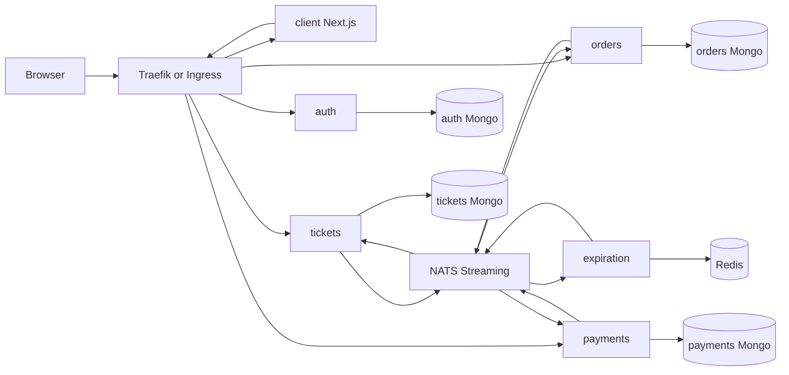
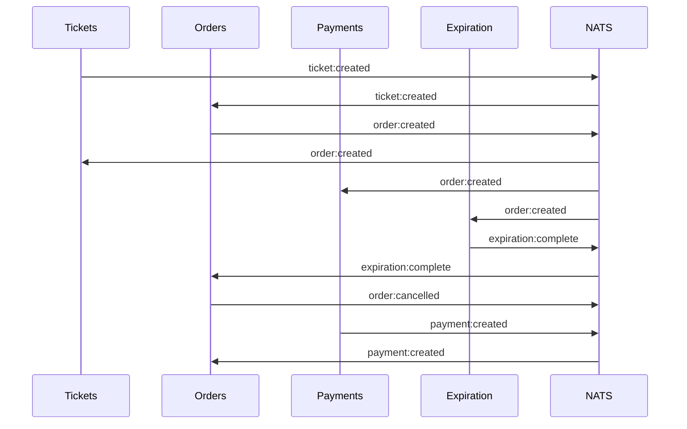

# Footlight

[](https://github.com/PooriaEshghi/ticketing/actions/workflows/ci.yml)

Biglietteria a microservizi per eventi dal vivo. Un acquirente sceglie un posto, lo tiene per quindici minuti e paga in modalità test di Stripe. Se il tempo scade, il posto torna in bacheca.

Footlight is a microservices ticketing desk for live events. A buyer reserves a seat for fifteen minutes and pays with Stripe in test mode. If the hold expires, the seat goes back on the board.

Il nome precedente, nel corso da cui nasce il codice, era GitTix. Le alternative considerate sono Aisle e Stubline. Footlight è quella usata nel client, nelle immagini e nel cluster NATS.

## Origine del progetto

Il progetto nasce seguendo il corso di Stephen Grider *Microservices with Node JS and React*, poi è stato esteso per poterlo pubblicare come portfolio:

- segreti tolti dal git (`client/.env`, artifact `client/.next`, chiave Stripe hardcoded) e `.env.example` per ogni servizio
- istruzioni, non eseguite, per ripulire la cronologia con `git filter-repo` (`docs/git-history-cleanup.md`)
- dipendenze di expiration (`bull`, `ioredis`) e test sul job di scadenza
- rimossi la pagina `banana`, il gitlink `common` vuoto, la sandbox `nats-test` e gli errori duplicati in auth. La libreria condivisa è il pacchetto npm `@petickets/common`
- client ridisegnato, ancora su Pages Router, con `@stripe/react-stripe-js` al posto di `react-stripe-checkout`
- Dockerfile multi-stage, Compose con Traefik, healthcheck, overlay k3s
- CI (lint, typecheck, test) e CD verso GHCR e una VPS
- script di seed e guida di deploy

## Architettura



Ogni servizio che tiene stato ha il proprio MongoDB. Expiration non ha un database: accoda i job su Redis con Bull. Il client, in render lato server, chiama gli altri servizi attraverso lo stesso proxy (`INTERNAL_API_URL`), inoltrando il cookie di sessione.

Each stateful service has its own MongoDB. Expiration has no database: Bull queues jobs in Redis. During server rendering the client calls the other services through the same proxy (`INTERNAL_API_URL`) and forwards the session cookie.

| Path | Servizio |
| --- | --- |
| `/api/users` | auth |
| `/api/tickets` | tickets |
| `/api/orders` | orders |
| `/api/payments` | payments |
| tutto il resto | client |

## Flusso degli eventi

I nomi sono quelli di `@petickets/common`.



1. Il venditore crea un biglietto. `tickets` pubblica `ticket:created`. `orders` salva una copia con lo stesso id e la stessa version.
2. Un aggiornamento di titolo o prezzo pubblica `ticket:updated`.
3. L'acquirente crea un ordine. `orders` pubblica `order:created` con `expiresAt` a quindici minuti. `tickets` marca il biglietto come riservato. `payments` salva prezzo e proprietario. `expiration` mette un job Bull che scatta a `expiresAt`.
4. Se nessuno paga, il job pubblica `expiration:complete`. `orders` annulla l'ordine se non è già `complete` e pubblica `order:cancelled`. `tickets` libera il posto. `payments` segna l'ordine come annullato.
5. Il pagamento con carta di test crea un charge Stripe e pubblica `payment:created`. `orders` passa l'ordine a `complete`. Un `expiration:complete` arrivato dopo non lo annulla.

Un annullo esplicito dell'utente fa lo stesso percorso di `order:cancelled`.

## Concorrenza ottimistica

I documenti replicati usano `mongoose-update-if-current`. La version parte da 0 e cresce a ogni `save`. Il listener in `orders` applica `ticket:updated` solo se trova il documento con `version === event.version - 1` (`Ticket.findByEvent`). Se l'evento è in anticipo rispetto alla copia locale, il listener lancia un errore e non fa ack: NATS Streaming riconsegna il messaggio. Un biglietto già riservato (`orderId` impostato) non si può modificare.

Replicated documents use `mongoose-update-if-current`. The version starts at 0 and increments on save. The orders listener applies `ticket:updated` only when the stored version is exactly `event.version - 1`. An event that arrives early is not acked, so NATS Streaming redelivers it. A reserved ticket cannot be edited.

## Segreti

Non committare chiavi. I file `.env` sono ignorati. Copia gli example e compila i valori solo in locale o sulla VPS:

```bash
copy .env.example .env
```

Su Kubernetes i valori stanno nei Secret `jwt-secret` e `stripe-secret` (`infra/k8s-prod/secrets.example.yaml` ha solo segnaposto). La CD li legge dai GitHub Secrets e li scrive in `/opt/footlight/.env` sulla VPS.

Stripe è solo test. In pagina ordine la carta mostrata è `4242 4242 4242 4242`.

Se una chiave è già stata pubblicata su GitHub, revocala. La cronologia di `master` può contenerla ancora: `docs/git-history-cleanup.md`.

## Avvio locale con Docker Compose

Serve Docker. Nella root:

```bash
copy .env.example .env
```

Metti in `.env` una `JWT_KEY` qualsiasi e, per provare il pagamento, `STRIPE_KEY` (`sk_test_…`) e `STRIPE_PUBLISHABLE_KEY` (`pk_test_…`).

```bash
docker compose up -d --build
docker compose --profile seed run --rm seed
```

Apri `http://localhost`. Entra come `demo@footlight.app` / `password` se hai lanciato il seed, oppure crea un account. Il cookie non è `Secure` in questo compose (`COOKIE_SECURE=false`) perché il sito è in HTTP.

I servizi nostri rispondono a `GET /health` (il client a `GET /api/health`).

## Avvio con Skaffold

`infra/k8s` resta il manifest di sviluppo: Ingress nginx, host `ticketing.dev`, un Mongo per servizio, Redis, NATS. Le immagini puntano a `ghcr.io/pooriaeshghi/ticketing-*` ma Skaffold le costruisce in locale (`push: false`, target Docker `development`).

```bash
skaffold dev
```

Prima crea i Secret:

```bash
kubectl create secret generic jwt-secret --from-literal=JWT_KEY=dev
kubectl create secret generic stripe-secret --from-literal=STRIPE_KEY=sk_test_xxx --from-literal=STRIPE_PUBLISHABLE_KEY=pk_test_xxx
```

Aggiungi `ticketing.dev` al file hosts verso l'IP dell'ingress. I cookie di questo manifest hanno `COOKIE_SECURE=true`, quindi il browser deve parlare HTTPS con l'ingress.

## Test

Ogni servizio:

```bash
npm ci
npm run lint
npm run typecheck
npm test
```

`npm run test:ci` è quello usato da GitHub Actions (Jest in `--runInBand`, senza watch). Il client non ha Jest: `test:ci` controlla che il brand e Stripe Elements siano al loro posto. I test di payments mockano Stripe e non chiamano la rete.

## CI/CD

`.github/workflows/ci.yml` parte su push e pull request. Una matrice copre auth, tickets, orders, payments, expiration e client, con cache npm, lint, typecheck e test.

`.github/workflows/cd.yml` parte solo su `master`. Costruisce il target `production` e pubblica:

- `ghcr.io/pooriaeshghi/ticketing-auth`
- `ghcr.io/pooriaeshghi/ticketing-tickets`
- `ghcr.io/pooriaeshghi/ticketing-orders`
- `ghcr.io/pooriaeshghi/ticketing-payments`
- `ghcr.io/pooriaeshghi/ticketing-expiration`
- `ghcr.io/pooriaeshghi/ticketing-client`

Ogni immagine ha il tag dello SHA e `latest`. Il deploy SSH parte solo se la variable `DEPLOY_ENABLED` è `true`. Sulla VPS esegue il pull dei sei servizi e `docker compose up -d`. NATS è costruito sulla macchina perché l'immagine ufficiale non ha un healthcheck utilizzabile. Dettagli, firewall e DNS: `docs/deploy.md`.

## Deploy Kubernetes su un nodo

`infra/k8s-prod` è un overlay Kustomize per k3s: toglie l'Ingress nginx di sviluppo, aggiunge un Ingress Traefik per `ticketing.paidastudio.com` e un `ClusterIssuer` cert-manager. Vedi `docs/deploy.md`.

## Licenza del corso

Il codice di partenza segue il corso di Stephen Grider. Questo repository è un progetto di studio e portfolio, non un prodotto di quel corso.
